# RIFT MAIDEN · 리프트 메이든
[브라우저에서 플레이하기](https://legerdo.github.io/rift-maiden/)

차원 균열이 도시를 삼키고 있다. 균열 추적자 **세라**는 총 한 자루를 들고 균열의 중심부로 향한다.

**RIFT MAIDEN**은 64x64 픽셀아트 미소녀를 직접 조종하는 **가로 사이드뷰 인크리멘탈 액션 슈터**입니다. 처음에는 펄스 SMG 한 자루로 벌레 몇 마리를 상대하지만, 몇 분 뒤에는 관통탄·분열탄·연쇄 번개·드론·유도 미사일·궤도 칼날이 맞물려 화면을 장악하고, 그 성장이 다시 다음 출격으로 이어집니다.

제목은 기본값 그대로 유지했습니다(세계관의 '균열'과 주인공 '메이든'을 가장 짧게 묶는 이름이라 바꿀 이유가 없었습니다).

| | |
|---|---|
| 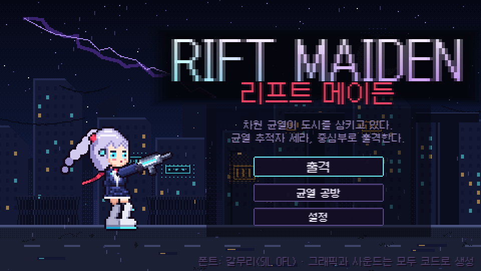 | 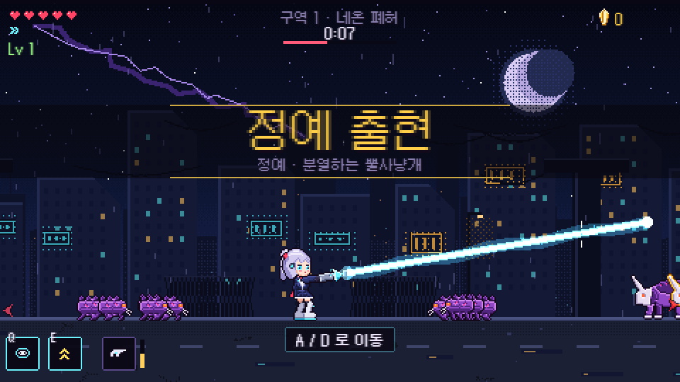 |
| 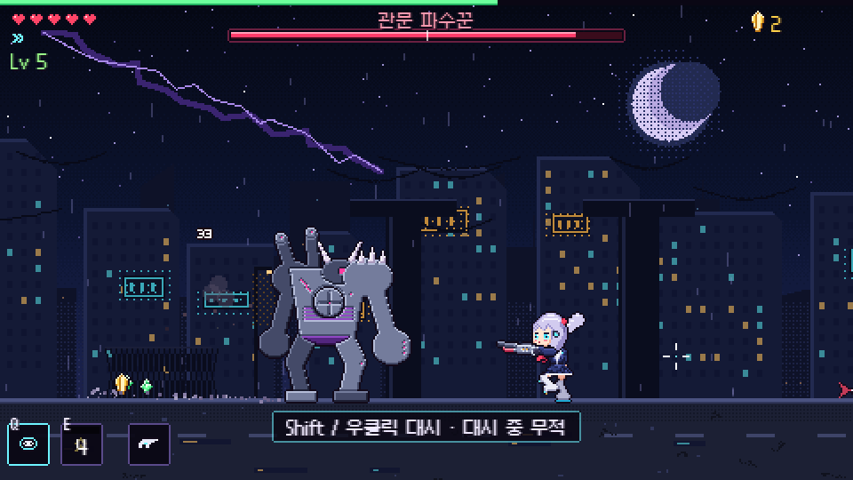 | 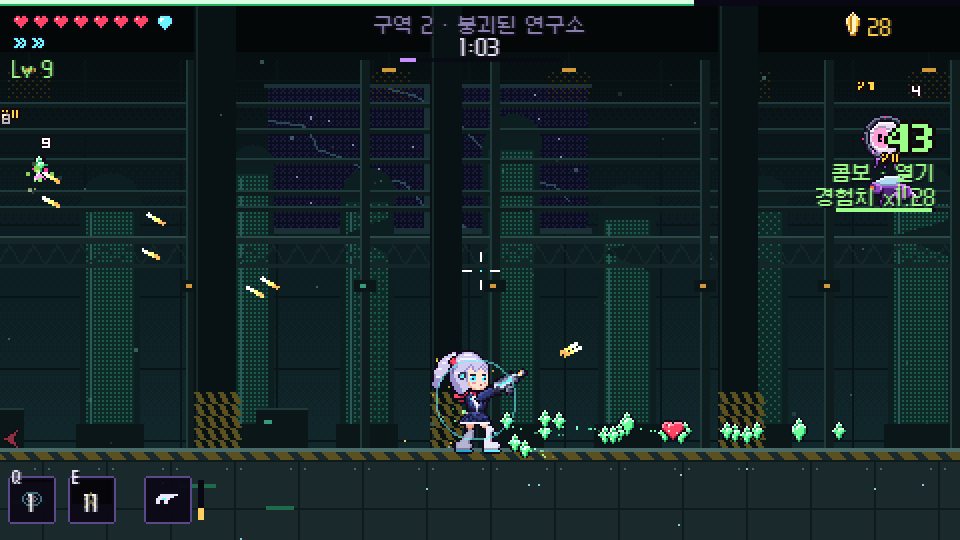 |
| 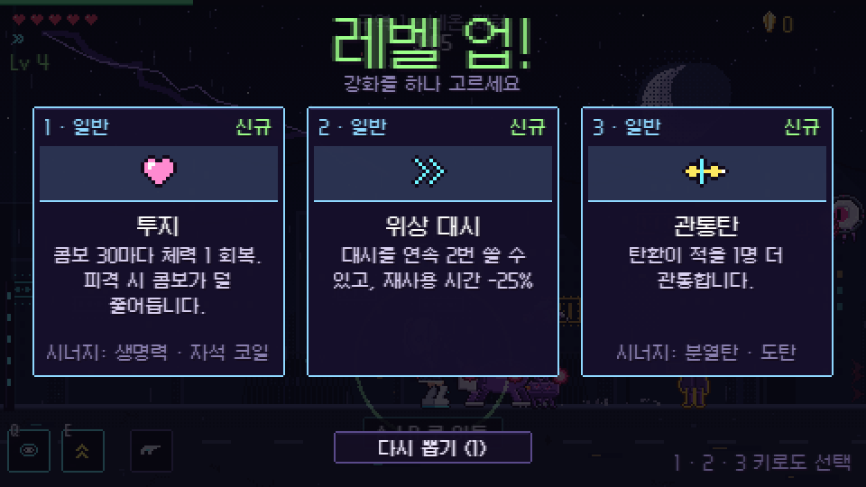 | 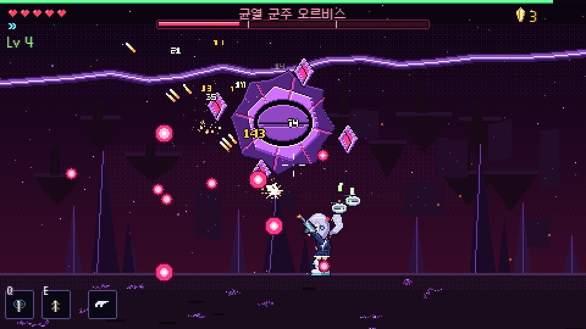 |
| 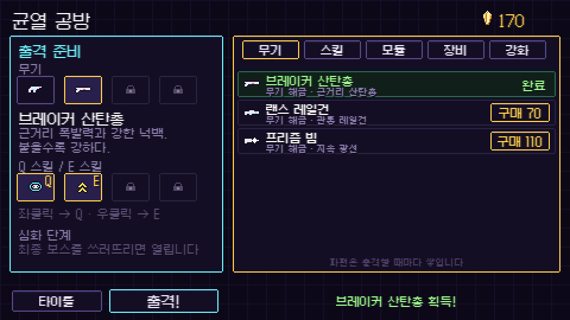 | 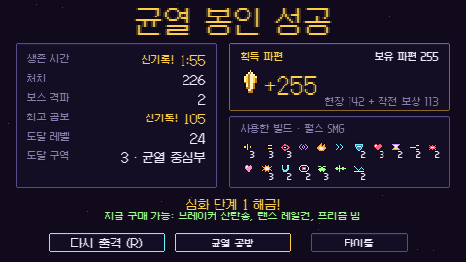 |
| 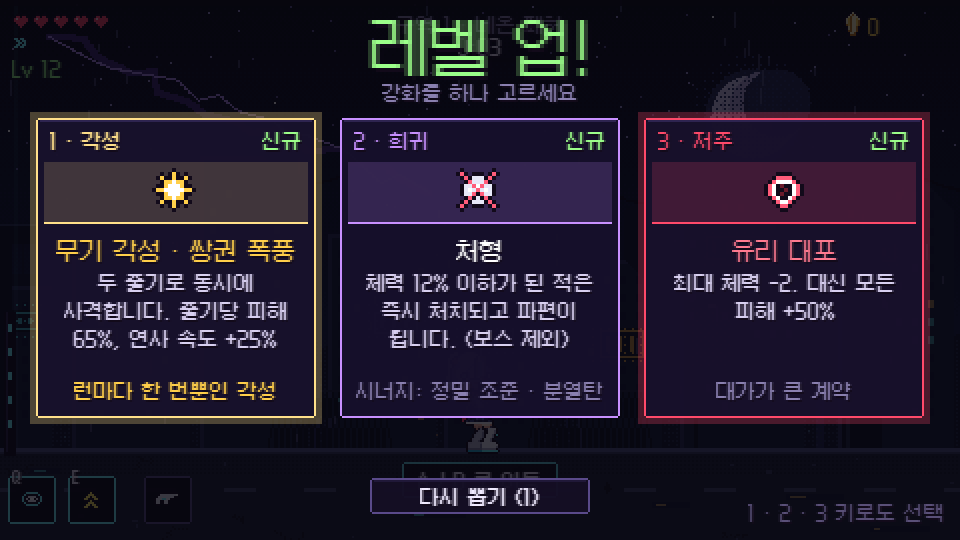 | 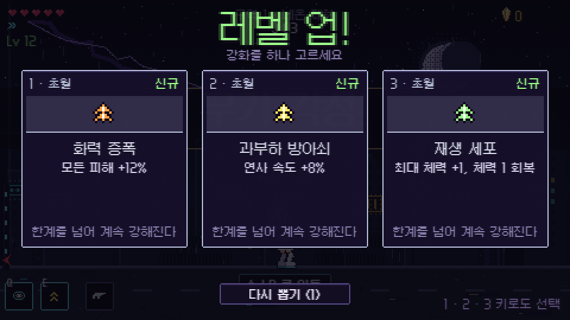 |
| 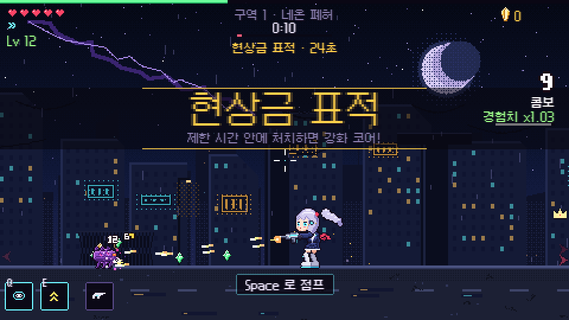 | |

> 모든 그래픽(캐릭터·적·보스·배경·아이콘)과 모든 효과음·음악은 이미지/오디오 파일 없이 **코드로 생성**됩니다. 한글 폰트만 [갈무리](https://github.com/quiple/galmuri)(SIL OFL 1.1)를 사용합니다.

---

## 핵심 특징

- **직접 조작하는 전투**: 즉각 반응하는 이동, 가변 점프, 무적 대시, 마우스 조준 사격. 대시로 적 공격을 아슬아슬하게 피하면 **완벽 회피**(슬로 모션 + 피해 보너스).
- **무기 4종, 손맛이 전부 다름**: 펄스 SMG(리듬), 브레이커 산탄총(충격량·반동), 랜스 레일건(순간 정지·관통), 프리즘 빔(지속 증폭·과열).
- **규칙을 바꾸는 강화 38종 + 융합 5종**: 관통 → 분열, 치명타 → 연쇄 번개, 드론 + 미사일 → 드론 군단처럼 서로 맞물립니다.
- **레벨 업이 비지 않는 성장**: Lv 12부터 무기마다 다른 **무기 각성**(런당 1회), 가끔 섞여 나오는 **저주 계약**(큰 대가 + 큰 보상), 장착 스킬 전용 강화, 일반 강화가 바닥날 즈음 무한히 쌓이는 **초월** 카드.
- **균열 이벤트**: 전투 중 약 50~60초마다 보급 캡슐 · 균열 폭주 · 현상금 표적 · 결정 비 중 하나가 터져 흐름을 바꿉니다.
- **점진적 자동화**: 지원 드론, 유도 미사일, 궤도 칼날, 자석 코일, 전술 드론 AI(적 탄환 격추). 잡일은 시스템이, 판단은 플레이어가.
- **행동이 다른 적 8종 + 정예 변종 4종 + 보스 2종**, 구역마다 다른 위험 요소(낙하 잔해, 균열 틈).
- **영구 성장**: 균열 파편으로 무기·스킬·강화 모듈·장비를 해금. 최종 보스 격파 후 **심화 단계**(난이도 변형) 개방.
- **완전 한국어 UI**, 정수 배율 픽셀 스케일링, 설정/저장/저장 초기화.

## 조작법

| 입력 | 동작 |
|---|---|
| A / D (또는 ← / →) | 좌우 이동 |
| 마우스 | 조준 |
| 좌클릭 (누르고 있기) | 사격 |
| Space / W / ↑ | 점프 (길게 누르면 더 높이) |
| Shift / 우클릭 | 대시 (대시 중 무적, 공중 1회) |
| Q / E | 액티브 스킬 |
| Esc / P | 일시정지 |
| 1 · 2 · 3 / R | 레벨 업 카드 선택 / 다시 뽑기 |
| R (결과 화면) | 즉시 재출격 |

점프는 보스의 지면 충격파와 뿔사냥개 돌진을 넘기 위해 실제로 필요해서 넣었습니다.

## 설치 · 실행 · 빌드 (Windows 11)

필요 환경: **Node.js 20.19 이상**(개발 시 24.13.0에서 확인), npm.

```powershell
npm install        # 의존성 설치 (버전 고정)
npm run dev        # 개발 서버 → 브라우저에서 http://localhost:5173 접속
npm run build      # 타입 검사 + 프로덕션 빌드 (dist/)
npm run preview    # 빌드 결과 미리보기 → http://localhost:4173
npm test           # 단위 테스트 (vitest)
```

`dist/` 폴더는 정적 파일이라 아무 웹 서버에 올려도 동작합니다(파일을 직접 여는 `file://` 방식은 브라우저 보안 정책 때문에 권장하지 않습니다).

처음 출격하면 짧은 인게임 튜토리얼이 나오고, 첫 판이 끝나면 타이틀의 **출격**은 **균열 공방**(장비 선택·영구 강화)으로 연결됩니다.

## 게임플레이 루프

**조준 → 사격 → 피격 확인 → 처치 → 결정 흡수 → 레벨 업 → 빌드 강화 → 더 많은 적 → 정예/보스 → 결과 → 균열 공방 → 재출격**

한 판은 약 11~12분입니다. 구역마다 50~60초 간격으로 균열 이벤트가 끼어듭니다.

| 구역 | 특징 | 마무리 |
|---|---|---|
| 1. 네온 폐허 | 기본 전투 학습. 균열 벌레·공허 사수·뿔사냥개·균열 말벌 | **보스: 관문 파수꾼** |
| 2. 붕괴된 연구소 | 비행·원거리 증가, 성벽 기사·균열 사제, 천장 **낙하 잔해** | **침입 경보**: 정예 3체 러시 |
| 3. 균열 중심부 | 모든 적 + 불안정체, 적을 계속 뱉는 **균열 틈** | **최종 보스: 균열 군주 오르비스** |

## 성장 시스템

- **순간 성장 (수 초)**: 초록 결정(경험치), 콤보 배율(최대 경험치 x1.5), 완벽 회피 버프, 오버드라이브, 회복 구슬, 강화 코어.
- **런 내부 성장 (한 판)**: 레벨 업마다 강화 3장 중 1장 선택. 카드에 등급·레벨·짧은 설명·보유 강화와의 **시너지**가 표시되고, 조건이 맞으면 금색 **융합** 카드가 등장합니다. 정예는 **12초 안에 처치해야** 강화 코어를 떨어뜨립니다(현상금 표적은 제한 시간 안에 처치하면 코어).

### 카드 종류

| 등급 | 내용 |
|---|---|
| 일반 · 희귀 | 관통·분열·도탄·다중 사격·치명타·폭렬탄·집중 사격·근접 광기·**처형**(체력이 적게 남은 적 즉사, 보스 제외)·**대구경탄**·드론·**자동 포탑**·자석·방어막·**반격 파동** 등 |
| 스킬 전용 | 장착한 스킬에만 붙는 강화: 확장 충격파(범위 + 번개), 끝없는 폭주(처치 시 오버드라이브 연장·관통), 연속 포격, 사건의 지평선(적 탄환 흡수) |
| 융합 | 두 강화를 모두 가지면 등장하는 금색 카드 5종 |
| **각성** | Lv 12부터 첫 칸에 고정으로 뜨는 런당 1회 카드. SMG `쌍권 폭풍`(두 줄기 사격), 산탄총 `용의 숨결`(화염 + 불탄 적 폭발), 레일건 `산란 레일`(첫 적중 시 세 갈래), 빔 `태양 광선`(굵고 강하고 덜 과열) |
| **저주** | Lv 6 이후 가끔 한 장 섞임. `유리 대포`(최대 체력 -2, 피해 +50%), `광란의 계약`(적 +40%, 경험치·파편 +40%), `사냥꾼의 표식`(정예 증가, 정예 코어 +1) |
| **초월** | 남은 일반 강화가 6단계 미만일 때부터 등장. 피해·연사·치명 피해는 무한 중첩, 최대 체력·쿨다운은 상한 있음. 풀이 바닥나도 선택지는 항상 3장 |

### 균열 이벤트

| 이벤트 | 내용 |
|---|---|
| 보급 캡슐 | 하늘에서 떨어지는 캡슐을 쏘아 열면 회복 + 파편 + 결정 |
| 균열 폭주 | 20초 동안 출현량 약 1.8배, 적이 빨라지고 경험치 x1.6 (구역 1은 80초 이후부터) |
| 현상금 표적 | 왕관이 붙은 정예를 제한 시간 안에 처치하면 강화 코어 + 파편, 놓치면 도주 |
| 결정 비 | 하늘에서 경험치 결정이 쏟아짐. 줍는 동안에도 적은 계속 옵니다 |
- **영구 성장 (런 종료 후)**: 균열 파편으로 균열 공방에서 구매.
  - 무기: 브레이커 산탄총, 랜스 레일건, 프리즘 빔
  - 스킬: 궤도 포격, 중력 균열
  - 모듈(강화 풀 확장): 번개, 미사일 포드, 냉각, 폭파 공학, 궤도 칼날, 전술 드론 AI, 환영 기술 — 각 모듈이 새 강화와 융합을 추가
  - 장비: 자동 회수 장치, 재추첨 칩, 선행 연구(시작 강화 1개), 호위 드론, 긴급 재구성(1회 부활)
  - 강화(소량 수치): 최대 체력, 파편 획득량, 기본 자석
  - **심화 단계 1~5**: 최종 보스 격파 시 해금. 적 체력·출현량·정예 확률이 오르고 파편 보상이 늘어납니다. 초기화형 프레스티지 대신 난이도 변형으로 설계했습니다.

사망해도 모은 파편과 작전 보상은 그대로 남고, 결과 화면에서 **지금 구매 가능한 항목**을 바로 알려줍니다.

## 주요 무기와 빌드 예시

| 무기 | 성격 |
|---|---|
| 펄스 SMG | 초당 10발, 치명타·연속 적중 계열과 궁합. 전용: 추적탄 |
| 브레이커 산탄총 | 7발 산탄, 강한 넉백과 자기 반동, 코앞에서 맞히면 피해 +50%. 전용: 반동 도약(공중에서 아래로 쏘면 솟구침 → 착지 충격파) |
| 랜스 레일건 | 느리지만 일직선의 모든 적을 관통, 방패 무시, 히트스톱. 전용: 초전도 레일(3명 이상 관통 시 즉시 재충전) |
| 프리즘 빔 | 누를수록 최대 2배까지 증폭, 과열 관리. 전용: 분광 렌즈(3갈래 굴절) |

시너지 예시:
- **관통탄 + 분열탄 (+ 연쇄 번개 → 융합 `뇌전 파편`)**: 관통할 때마다 탄이 갈라지고, 파편의 치명타가 번개를 부르고, 번개 처치가 다시 파편을 흩뿌립니다.
- **폭렬탄 + 연쇄 폭발 → 융합 `연쇄 반응`**: 폭발로 죽은 적이 더 큰 폭발을 일으켜 파도처럼 번집니다.
- **지원 드론 + 유도 미사일 → 융합 `드론 군단`**, **전술 드론 AI**로 드론이 사제·사수를 먼저 노리고 적 탄환을 격추.
- **빙결탄 + 정밀 조준 → 융합 `절대 영도`**: 언 적은 무조건 치명타, 처치 시 얼음 파편 폭발.
- **위상 대시 + 잔상 베기 → 융합 `환영 무희`**: 대시 자리에 분신이 남아 함께 사격.

## 왜 손맛이 나는가

모든 피드백은 입력부터 결과까지 이어지고, 강도는 공격의 위력에 비례합니다.

- **Recoil**: 총을 든 팔 스프라이트가 조준 반대 방향으로 밀렸다가 복귀하고 살짝 들립니다. 산탄총·레일건은 캐릭터 자체도 뒤로 밀립니다.
- **머즐 플래시·탄피**: 무기별로 다른 플래시(작은 별/큰 화염/시안 십자/빔 발광), SMG·산탄총은 탄피가 튀어 바닥에서 튕깁니다.
- **무기별 사운드**: SMG 짧은 클릭, 산탄총 저음 폭음 + 꼬리, 레일건 충전음 + 크랙, 빔은 누르는 동안 이어지는 루프(증폭될수록 음높이 상승). 연사음은 보이스 제한과 음높이 변주로 뭉개지지 않게 처리.
- **Hit feedback**: 쿨다운이 있는 흰색 히트 플래시, 위력에 따라 커지는 임팩트 스파크, 치명타·약점은 다른 색/소리/큰 숫자. 같은 대상의 연타는 숫자 하나로 합쳐집니다.
- **Hit-stop**: 레일건·산탄 적중, 정예 처치, 보스 치명타, 피격, 보스 강타 등 무거운 순간에만 수십 ms 정지.
- **Camera impulse**: 트라우마 기반 흔들림 + 조준 반대 방향 킥 + 레일건·스킬의 짧은 줌 펀치. 설정에서 끄기/약하게/보통 선택.
- **Enemy reaction**: 넉백과 큰 충격 시 튀어오름, 처치 시 번쩍임·찌그러짐의 짧은 "죽음의 박자" 후 파편과 에너지가 터지고 자원이 튀어나옵니다. 정예는 폭발과 링까지.
- **Particles**: 픽셀 스파크(속도 잔상), 튕기는 파편, 먼지, 연기, 번개, 충격 링 — 모두 정수 좌표 사각형이라 픽셀 스타일 유지. 폭발 스프라이트는 동시 개수를 제한해 화면을 가리지 않습니다.
- **Resource attraction**: 결정이 튀어나옴 → 바닥에서 떠 있음 → 근처에 가면 가속하며 빨려옴 → 연속 흡수할수록 음높이가 올라가는 소리. 자석 코일을 얻으면 흡수 범위가 캐릭터 주변에 점선으로 표시됩니다.
- **Progression feedback**: 레벨 업 순간 슬로 모션 + 링 + 스파크, 선택한 강화 이름이 캐릭터 위에 뜨고, 융합은 금색 배너와 화면 플래시. 콤보 단계(리듬·열기·폭주·균열 붕괴)마다 색과 사운드가 바뀝니다.
- **Secondary motion**: 세라의 포니테일과 빨간 스카프 꼬리는 버렛 로프 물리로 이동·대시·점프에 따라 휘날립니다. 뒷걸음질 때는 달리기 사이클이 역재생됩니다.
- **가독성 우선순위**: 적 탄환은 흰 심 + 분홍 + 어두운 테두리로 항상 가장 눈에 띄는 위치(레이어)에 그리고, 위험한 공격은 모두 붉은 텔레그래프(점선·지면 표식·기둥)로 미리 예고합니다. 배경은 어둡고 채도를 낮춰 캐릭터·적과 분리했습니다.

## 개발 구조

```
src/
  main.ts            폰트 로드 + Phaser 설정 (480x270 논리 해상도, 정수 배율)
  core/              상수, 수학, RNG, 저장(검증/복구), 스케일링, 앱 싱글턴
  data/              무기·강화·적·구역(웨이브)·스킬·메타·밸런스 수치 (데이터 기반)
  localization/      한국어 문자열(ko.ts) + t() 헬퍼
  art/               절차적 픽셀아트: 재질/음영/외곽선 버퍼, 히로인 퍼펫, 적·보스·FX·배경·아이콘
  audio/             오프라인 SFX 합성기, 칩튠 시퀀서, 버스/보이스 제한 엔진
  game/              플레이어, 적 AI, 탄환, 전투 파이프라인, 자동화, 스킬, 보스, 디렉터, FX, 카메라 등
  scenes/            Boot, Title, Hub(균열 공방), Game, Hud, LevelUp, Pause, Settings, Result
  ui/                픽셀 텍스트·패널·버튼·슬라이더
tests/               vitest 단위 테스트
scripts/             Playwright 자동 플레이 테스트(qa-playtest.mjs), 입력/오디오 점검(qa-input-audio.mjs)
docs/screenshots/    자동 테스트 중 촬영한 스크린샷
```

- 새 적은 `data/enemies.ts` + `game/enemy.ts`의 행동 함수 + `art/enemiesArt.ts` 드로어로 추가합니다.
- 새 구역·웨이브는 `data/zones.ts`의 데이터만으로 추가됩니다.
- 새 강화는 `data/upgrades.ts` 정의 + `localization/ko.ts` 문구 + 효과 적용 위치(대부분 `game/combat.ts`, `game/build.ts`)로 추가합니다.
- 플레이어에게 보이는 문자열은 전부 `localization/ko.ts`에 있습니다.

저장은 `localStorage`(`riftmaiden.save.v1`)를 사용하고, 불러올 때 모든 필드를 검증합니다. 손상된 저장은 `.corrupt` 키로 백업한 뒤 초기 상태로 시작하므로 게임이 멈추지 않습니다. 설정 화면(타이틀에서 진입)에서 두 번 눌러 저장을 초기화할 수 있습니다.

## 테스트 결과

작업 환경: Windows 11, Node 24.13.0, npm 11.5.2, Microsoft Edge(헤드리스, Playwright로 구동).

| 항목 | 방법 | 결과 |
|---|---|---|
| 타입 검사 | `tsc --noEmit` | 통과 |
| 단위 테스트 | `npm test` (vitest 30개): 저장 검증·복구·초기화, 강화 풀/조건/융합, **각성(Lv 12, 1회)·저주(Lv 6+, 최대 1장)·초월(풀 고갈 시 보충)·스킬 전용 카드 조건**, Lv 2~80까지 레벨 업마다 항상 3장이 나오는지, 빌드 수치, XP·콤보·보상·다중 사격 분배 곡선, 데이터 무결성, 한국어 키 누락, 충돌 수학, 공간 격자, 모든 SFX가 유효한(유한·들림·클리핑 없음) 신호인지 | 30/30 통과 |
| 프로덕션 빌드 | `npm run build` → `vite preview`에서 자동 스모크 테스트 | 통과, 콘솔 오류 0 |
| 타이틀 → 게임 진입, 이동·사격·점프·대시 | `node scripts/qa-playtest.mjs smoke` | 통과 |
| 짧은 키 입력(한 프레임 미만 탭) 인식, 오디오 컨텍스트 기동 | `node scripts/qa-input-audio.mjs` | 통과 (SFX 버퍼 60개, 구역 음악 전환 확인) |
| 전체 루프: 구역1 → 파수꾼 → 구역2 정예 러시 → 구역3 → 오르비스 → 승리 결과 | `full` 시나리오 (무적 + 자동 조작 봇, 구역 시간과 보스 체력은 QA 훅으로 단축) | 통과, 콘솔 오류 0 |
| 사망 → 결과 → 균열 공방 → 구매 → 장착 → 재출격(산탄총) → 새로고침 후 저장 유지 → 손상된 저장 복구 | `meta` 시나리오 | 통과 |
| 보스 패턴·페이즈, 무기 4종, 스킬 4종 화면 | `boss`, `weapons`, `orbis` 시나리오 스크린샷 검토 | 확인 |
| 일시정지 · 설정 · 복귀 | `ui` 시나리오 | 통과 |
| 사망 → 결과 → R 재출격 2회 반복 | `retry` 시나리오 | 통과 (매번 새 런으로 초기화) |
| 밸런스 | 무적 봇으로 실제 시간 전체 런(구역1 → 오르비스 → 승리), 비무적 봇 생존·피격 원인 로그, `bossfight` 시나리오로 무기별 보스전 시간 측정 | 아래 "밸런스 조정" 참고 |
| 새 카드 · 이벤트 화면 | `cards` 시나리오: 각성/저주/초월/스킬 전용 카드 선택, 4가지 균열 이벤트 강제 발동 | 통과, 스크린샷 검토 |
| 성능 | 모든 시나리오 중 `actualFps` 로그 | 헤드리스 환경에서 약 118~120fps 유지 |

### 밸런스 조정 (1스테이지 난이도 · 강화 고갈 문제)

문제: 구역1이 너무 쉽고, 구역2에서 이미 고를 강화가 바닥났습니다. 조정 전 무적 봇은 **구역1 종료 시점에 Lv 23**이었습니다.

바꾼 것:
- **성장 속도**: 레벨당 피해 보너스 3% → 1%, XP 곡선을 중반 이후 가파르게, 콤보 경험치 최대 x2 → x1.5, 근접 광기 경험치 x2 → x1.5, 정예 경험치 x10 → x7, 구역2·3 경험치 배율 하향. 정예 강화 코어는 **12초 안에 처치했을 때만**(무작위 정예 출현률도 하향).
- **난이도**: 구역별 적 체력 상향(1.3 / 2.8 / 4.4배) + 구역 안에서 최대 1.7배까지 상승, 출현 속도·동시 수 증가, 필드가 비면 출현 가속, 구역1 정예 3회 + 뿔사냥개 무리. 균열 벌레는 **웅크렸다 도약**, 공허 사수는 중반부터 **2~3연사**(동시에 조준하는 사수 수는 제한해 읽을 수 있게 유지).
- **화력 편차**: 다중 사격은 탄당 피해를 나눠 갖고(2발 80% · 3발 73% · 4발 70%), 폭렬탄의 최소 폭발 피해를 낮춰 연사 무기가 보스를 녹이던 문제를 줄였습니다. 보스 치명타 히트스톱은 빈도 제한(보스전 실제 시간의 11~18%가 정지로 사라지던 문제). 산탄총 근접 명중 +50% · 연사/사거리 소폭 상향, 레일건 피해 52 → 60, 빔 피해 4.6 → 5.4 · 과열 복귀 빠르게.
- **보스 체력**: 파수꾼 12000 → 22000, 오르비스 20000 → 32000 (구역 배율 곱해짐).

측정 결과(최종 수치, 프로덕션 빌드, 모듈 미해금 새 저장):

| 항목 | 결과 |
|---|---|
| 무적 봇 레벨 | 구역1 끝 **Lv 15**(선택 17회), 구역2 끝 Lv 20, 구역3 후반 Lv 25 (조정 전: 구역1 끝 Lv 23) |
| 강화 고갈 | 무적 봇 기준 구역3 중반(Lv 23 전후)부터 일반 강화가 바닥나기 시작하고, 그 뒤로는 초월 카드가 채워서 항상 3장이 나옴. 모듈을 해금하면 일반 풀이 37~46 → 60~69단계로 늘어나 더 오래 갑니다 |
| 비무적 봇 | 구역1 동안 1~2회 피격으로 생존, 파수꾼전에서 사망(최종 수치에서는 파수꾼 체력 4%까지 몰아붙임) |
| 보스전 시간 (무적 봇) | 파수꾼 약 50초(실제 런에서 봇이 만든 Lv 15 빌드), 오르비스 약 52초(같은 런의 구역3 빌드). 같은 중간 빌드(Lv 14, 강화 13개)로 잰 파수꾼: 레일건 36초 · SMG 63초 · 빔 72초 · 산탄총(근접전) 77초 |
| 한 판 길이 | 무적 봇 기준 약 11~12분 |

- 봇은 탄 위치를 매 프레임 읽고 조준이 정확한 대신 보스 패턴 회피가 서툽니다. 사람 기준 체감 난이도는 이 표와 다를 수 있습니다.

### 확인하지 못한 것 (정직하게)

- **사람이 직접 한 플레이 테스트는 하지 않았습니다.** 조작감·손맛은 자동 봇 플레이, 프레임 스크린샷 검토, 수치 로그로 확인했습니다. 실제 손으로 느끼는 반응성·난이도는 사람의 플레이로 한 번 더 조정하는 것을 권장합니다.
- **소리를 직접 듣지 못했습니다.** 오디오는 오류 없이 기동하고 모든 효과음이 유효한 신호라는 점만 자동 검증했습니다. 음량 밸런스와 음색은 청취 확인이 필요합니다.
- Edge(Chromium) 외 브라우저(Firefox, Safari)와 실제 GPU 창 모드 성능은 확인하지 않았습니다.

### 자동 플레이 테스트 직접 돌려보기

개발 서버(`npm run dev`)를 켠 상태에서 다른 터미널에서 실행합니다. 설치된 Edge(없으면 Chrome)를 사용하며 스크린샷은 `qa-output/`에 저장됩니다.

```powershell
npm run qa -- smoke          # 기본 조작 + 20초 자동 플레이
npm run qa -- full           # 전 구역 → 승리까지 (단축)
npm run qa -- meta           # 결과 → 공방 구매 → 재출격 → 저장 유지
npm run qa -- bot --time=240 # 자동 봇 실전 플레이 (피격 원인·레벨·제시된 카드 로그)
npm run qa -- bot --god --time=700            # 무적 봇으로 전체 런 (레벨 곡선·강화 고갈 확인)
npm run qa -- bossfight --god --weapon=rail --level=14 --build=multishot,crit,awaken  # 보스전 시간 측정
npm run qa -- cards          # 각성·저주·초월 카드와 균열 이벤트 화면
npm run qa:input             # 짧은 키 입력·오디오 기동 확인
```

## 알려진 제한사항

- 키보드 + 마우스 전용입니다(게임패드·터치 미지원).
- 밸런스는 자동 봇 기준으로 맞췄기 때문에, 사람 기준으로는 공허 사수 탄환 난이도나 보스 체력이 다소 다르게 느껴질 수 있습니다. 봇 테스트는 한 번에 ±40% 정도 흔들리므로 표의 초 단위는 대략값입니다. 주요 손잡이:
  - 구역별 적 체력·경험치·출현량: `src/data/zones.ts` (`hpMul`, `xpMul`, `phases`)
  - 레벨 곡선·콤보·정예 코어 제한 시간: `src/data/balance.ts` (`xpForLevel`, `COMBO`, `ELITE_QUICK_KILL`)
  - 보스 체력: `src/game/bosses.ts`의 `createBoss`
  - 카드 등장 규칙(각성 레벨, 저주 확률, 초월 개방 시점): `src/data/upgrades.ts`의 `rollOffers`
- 창이 포커스를 잃으면 자동으로 일시정지됩니다.
- 진행은 브라우저 저장소에 저장되므로 브라우저 데이터를 지우면 초기화됩니다.
- 개발 서버나 `?qa` 주소 파라미터에서는 자동 테스트용 디버그 훅(`window.__RM`)이 활성화됩니다.

## 향후 확장 포인트

- 주인공 추가(데이터 + 퍼펫 포즈 재사용), 무기별 전용 강화 추가.
- 구역·보스 추가: `data/zones.ts` 데이터와 `BossCtl` 인터페이스 구현만으로 연결됩니다.
- 무피격 보너스 게이지, 일일 시드 도전, 기록 화면.
- 게임패드 입력(`Intent` 구조가 입력 장치와 분리되어 있어 추가가 쉽습니다).
- 다국어: `localization/`에 언어 파일을 추가하고 `setLanguage()`로 교체.

## 제작 프롬프트

이 게임을 만들 때 사용한 원문 프롬프트는 [docs/original-prompt.md](docs/original-prompt.md)에 그대로 보관되어 있습니다.

## 크레딧 · 라이선스

- 폰트: 갈무리(Galmuri) © Lee Minseo, SIL Open Font License 1.1 — `public/licenses/`에 원문 포함.
- 게임 엔진: Phaser 3.90.0 (MIT).
- 그 외 모든 그래픽·사운드·음악은 이 저장소의 코드로 생성됩니다.
